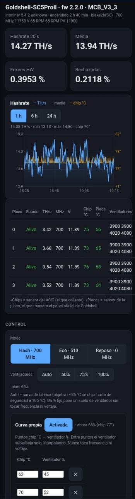
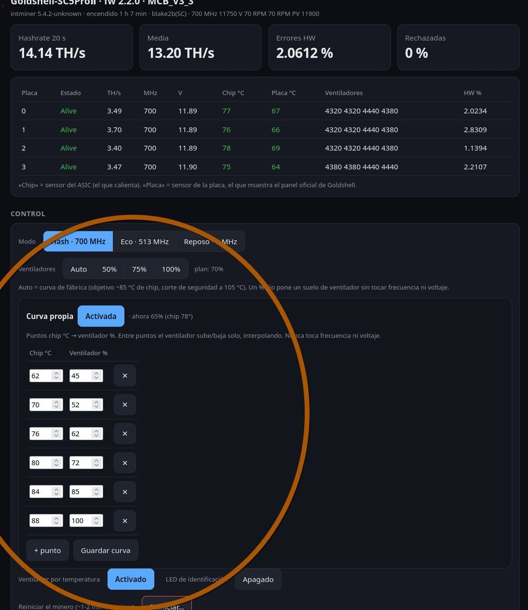

# sc5-flasher

A dark, local **dashboard and control panel for the Goldshell SC5 Pro Ⅱ** (board
`MCB_V3_3`, firmware 2.2.0), with a software fan curve. It talks to the miner over
its own stock HTTP and cgminer APIs — **no firmware flashing, no factory reset, no
SSH** — so it cannot brick the miner.

Inspired by [connorslab/paperclip-flasher](https://github.com/connorslab/paperclip-flasher)
(which targets the Goldshell KDBox, a different board); this is a separate, read-
and-control tool for the SC5 Pro Ⅱ.

## Screenshots

The dark dashboard, with the hashrate + chip-temperature graph (1 h / 6 h / 24 h):



The controls and the software fan curve:



> **Safety first.** Every write is a fixed, reversible operation from a closed
> allowlist (`sc5/control.py`). The browser only sends an *action name*, never a
> device path or raw payload, so there is no code path to `/mcb/facrst` (factory
> reset) or `/mcb/uploadimage` (firmware). The fan controls only ever change the
> fan %, never clock or voltage. Tests enforce this.

## Features

- **Live dashboard:** hashrate (20 s and average), per-board TH/s, clock, voltage,
  chip vs board temperatures, fans and hardware-error %, and the pools.
- **Graph:** a dependency-free canvas chart of recent hashrate (with the average
  overlaid), chip temperature and the fans' average speed. Click a legend entry to
  show or hide that series (remembered in the browser). A background sampler
  records history even with no browser open, persisted so the graph survives a
  service restart.
- **Controls** (with `--control`): power mode (Hash / Eco / Idle factory presets),
  fan floor (Auto / 50 / 75 / 100 %), identification LED, temperature fan control,
  reboot, and **pool priority** (move a pool to the top, up or down).
- **Software fan curve:** a list of `chip °C → fan %` points; the fan ramps up and
  down on its own, interpolating between points. A hard override forces 100 % fans
  above a safety temperature, whatever the curve says.

Python 3.9+, no third-party dependencies.

## Dashboard (read-only)

```sh
python3 -m sc5 status 192.168.1.50          # one-shot report (use your miner's IP)
python3 -m sc5 status 192.168.1.50 --json   # same, as JSON
python3 -m sc5 serve  192.168.1.50          # dark dashboard on http://127.0.0.1:8099
python3 -m unittest                         # tests
```

In read-only mode nothing is ever written: the cgminer API is limited to
`version/summary/devs/pools/stats` and the web API to `GET` on a fixed set of paths.

## Control panel

```sh
# the miner's dashboard password, kept OUT of the repo:
install -m700 -d ~/.config/sc5-flasher
printf 'SC5_WEB_PASSWORD=your_password\n' > ~/.config/sc5-flasher/secrets.env
chmod 600 ~/.config/sc5-flasher/secrets.env

python3 -m sc5 serve 192.168.1.50 --control            # localhost only
python3 -m sc5 serve 192.168.1.50 --control --bind 0.0.0.0   # reach it from your LAN
```

The panel has no login of its own, so bind it to `127.0.0.1` or a trusted LAN,
never to the Internet. The password is read from `secrets.env`, never from the
browser and never committed.

### Pool priority

The miner mines on the first live pool of its list and keeps the rest as failover,
in order. The ⇈ / ↑ / ↓ buttons reorder that list exactly like dragging a row in the
stock web UI: the panel reads the miner's own pool list, moves one entry, renumbers
`pool-priority` and sends the same list back (`PUT /mcb/pools`). URLs, workers and
passwords go back unchanged; pools are never added or removed (`newpool` /
`delpool` stay blocked). Moving a pool to the top switches mining to it, and the
panel asks first.

A pool change only restarts the miner's mining process (also from the stock UI),
and on the SC5 Pro II the hash boards do not come back from that: chip sensors stay
at -60 °C and the hashrate near zero. So after saving the new order the panel does a
full reboot, which brings the boards back with the new order in about 2 minutes. The
panel says so before every change.

### Software fan curve

The stock firmware's temperature target lives in a file on the miner that is only
reachable over SSH, which is closed on this firmware. So the panel runs its own
curve on the one safe lever — the fan floor. Define points like:

| Chip °C | Fan % |
| --- | --- |
| 62 | 45 |
| 70 | 52 |
| 76 | 62 |
| 80 | 72 |
| 84 | 85 |
| 88 | 100 |

Between points the fan % is interpolated; the fan never drops as temperature rises,
never goes below a 40 % floor, and is forced to 100 % above the safety temperature.
Picking a fixed fan % disables the curve.

**The miner protects itself regardless:** its firmware shuts the hashboard down on
overheat (cutoff ~105 °C chip / ~89 °C board), independent of this panel.

## Always-on service

See [`sc5-panel.service.example`](sc5-panel.service.example) for a systemd user unit
that keeps the panel running and starts it on boot. Fill in your paths and IP.

## How it works

Notes on the miner's APIs and the SSH analysis are in [docs/recon.md](docs/recon.md).

## License

MIT — see [LICENSE](LICENSE).
